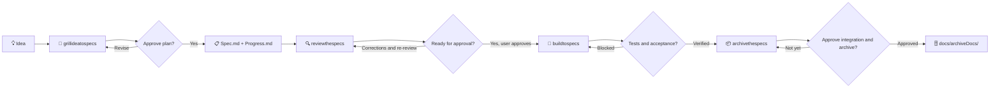

<div align="center">

# 🧠 weSkills

### From *“What if…”* to *“Done, verified, and archived.”*

**Seven portable agent skills for specifying, independently reviewing, building, verifying, testing, improving and safely delivering software.**

[](https://agentskills.io/specification)

[](LICENSE)


**[Quick start](#-quick-start) · [Core skills](#-core-delivery-skills) · [Independent review](#-independent-specification-review) · [Safety model](#-safety-is-a-feature) · [Examples](#-walkthrough) · [FAQ](#-faq)**

</div>

---

## ✨ Why weSkills?

Coding agents are great at writing code. They are less useful when the idea is still fuzzy, acceptance criteria are missing, or no one knows whether the last change actually passed its tests.

**weSkills adds a disciplined workflow without adding a heavyweight process.**

| Without a workflow | With weSkills |
| --- | --- |
| Agents guess what a feature should do | **grillideatospecs** asks one high-impact question at a time |
| An enormous, ambiguous implementation task | Small, cohesive specs with explicit dependencies and testable work units |
| “Looks done” replaces evidence | **reviewthespecs** challenges specification completeness; **buildtospecs** checks tests, Git and progress before calling a unit Complete |
| Stale documents drift away from shipped code | **archivethespecs** verifies acceptance and archives the completed record |
| Pushes, merges and cleanups surprise you | Explicit previews and approval gates keep people in control |

No ticket system. No required external orchestration framework. No invented passing tests.

## 🔄 The workflow



**One idea → plan approval → specs → independent review → final spec approval → verified build → controlled archival.**

## 🚀 Quick start

### 1. Get the skills

```bash
git clone https://github.com/VDandavate/weSkills.git
```

Each skill follows the [Agent Skills specification](https://agentskills.io/specification), with a discoverable `SKILL.md` containing YAML metadata and workflow instructions. <sup>[Format reference](https://agentskills.io/specification)</sup>

### 2. Install or point your agent at the skills

Where your agent supports local skill directories, copy or symlink the **seven skill folders** to its configured skills location. For example, on macOS/Linux, a skill-capable agent configured to scan `~/.agents/skills/` can use:

```bash
mkdir -p ~/.agents/skills
ln -s "$(pwd)/skills/grillideatospecs" ~/.agents/skills/grillideatospecs
ln -s "$(pwd)/skills/reviewthespecs" ~/.agents/skills/reviewthespecs
ln -s "$(pwd)/skills/buildtospecs" ~/.agents/skills/buildtospecs
ln -s "$(pwd)/skills/archivethespecs" ~/.agents/skills/archivethespecs
ln -s "$(pwd)/skills/improvecode" ~/.agents/skills/improvecode
ln -s "$(pwd)/skills/testthoroughly" ~/.agents/skills/testthoroughly
ln -s "$(pwd)/skills/qualityorchestrator" ~/.agents/skills/qualityorchestrator
```

Run these commands **from the cloned weSkills directory**. For Windows, or systems where symlinks are inconvenient, copy the folders instead.

> [!IMPORTANT]
> Skill discovery paths, slash commands and automatic activation vary by tool and version. `~/.agents/skills/` is an **example**, not a universal installation location. Check your agent's documentation. If a tool does not support skills, open the relevant `SKILL.md` as an instruction file and provide the project context explicitly. These files do not install a plugin or grant tools, Git access or permissions.

### 3. Use the workflow

```text
Use grillideatospecs. I want a simple volunteer shift scheduler for a community garden.
Ask exactly one clarification question at a time.
```

After reviewing and approving the proposed feature plan, `grillideatospecs` generates the specs, invokes `reviewthespecs`, resolves material findings, and asks for separate final specification approval. Then:

```text
Use buildtospecs for docs/specs/volunteerScheduling/.
Work on this one feature only. Verify prerequisites and required tests.
```

When every work unit is actually complete and accepted:

```text
Use archivethespecs for docs/specs/volunteerScheduling/.
Assess readiness and preview integration and archive operations.
Do not merge, push or archive without my explicit approval.
```

## 🔎 Independent specification review

**[reviewthespecs](skills/reviewthespecs/SKILL.md)** challenges requirement coverage, outcome completeness, integration, ownership and verification. When authorized, it writes package-level `ReviewReport.md` and `Traceability.md`. It reports `Ready for Approval`, `Changes Required` or `Blocked`, never implementation authorization.

**Automatic:** `grillideatospecs` invokes review after drafting and requests final specification approval after addressing authorized findings.

**Direct:** `Use reviewthespecs on docs/specs/volunteerScheduling/ against the original requirements. Do not edit files.`

New work-unit IDs use meaningful camelCase names. Preserve older approved IDs.

## 🧰 Core delivery skills

<table>
<tr>
<td width="33%" valign="top">

### 🔎 01. Grill

**[grillideatospecs](skills/grillideatospecs/SKILL.md)**

Turn an incomplete idea into an approved implementation plan.

- Learn the real repository first
- Ask **one** material question at a time
- Recommend sensible options
- Split work only when justified
- Create self-contained feature specs **after** approval

**Produces:** `Spec.md`, `Progress.md`

</td>
<td width="33%" valign="top">

### 🧪 02. Build

**[buildtospecs](skills/buildtospecs/SKILL.md)**

Implement one feature without losing track of what is true.

- Work unit by work unit
- Pragmatic Red → Green → Refactor
- Run the repository's required gates
- Separate implementation and progress commits
- Reconcile Git and resume after interruptions

**Produces:** tested code and evidence

</td>
<td width="33%" valign="top">

### 📦 03. Archive

**[archivethespecs](skills/archivethespecs/SKILL.md)**

Close completed work without rewriting history.

- Recheck tests and acceptance
- Reconcile recorded Git commits
- Preview merges, pushes and file moves
- Obtain explicit authorization
- Archive to a read-only destination

**Produces:** a verified, preserved record

</td>
</tr>
</table>

## 🗂️ What gets created?

The skills operate on the **target software repository**, not inside weSkills itself.

```text
yourProject/
├── AGENTS.md                       # Optional project-level rules
├── docs/
│   ├── specs/
│   │   └── volunteerScheduling/
│   │       ├── Spec.md             # Scope, work units, acceptance
│   │       └── Progress.md         # Status, tests, commit evidence
│   └── archiveDocs/
│       └── completedFeature/
│           ├── Spec.md             # Archived after approval
│           └── Progress.md
└── src/
```

**`Spec.md`** defines expected behavior and the work-unit contract. **`Progress.md`** records the real execution state. The only allowed unit statuses are **Pending**, **In Progress**, **Blocked**, and **Complete**. Both files are intentionally small enough for a new agent to pick up without prior conversation history.

A feature has one branch and one progress writer. Independent features may be developed concurrently in **separate worktrees**; work units within a feature run sequentially.

## 🧭 Walkthrough

Imagine a fictional community garden that needs a simple volunteer shift scheduling app.

**Grill:** The user wants volunteers to browse open shifts and coordinators to prevent double bookings. The agent inspects any existing application, asks about roles, schedule rules, cancellations and verification, proposes a few cohesive features, then waits for approval. Only then does it write `docs/specs/<featureName>/Spec.md` and `Progress.md`. No implementation or automatic spec commit occurs.

**Build:** The agent selects one approved feature, verifies the branch and existing tests, commits the initial spec baseline on its authorized feature branch, and executes the first eligible unit. It writes pragmatic tests before changing testable behavior, runs the complete mandatory gate, makes a work-unit implementation commit, and separately records the outcome in a progress commit. Failed checks mean **Blocked**, not “basically complete.”

**Archive:** The agent independently reviews the work units, acceptance, tests and Git evidence. It previews the exact integration and archive paths, then requests approval. After authorized operations it preserves the final feature documents under `docs/archiveDocs/` and treats them as read-only.

## 🛡️ Safety is a feature

This repository includes [**AGENTS.md**](AGENTS.md) with reusable naming, verification, Git and reporting conventions. Copy or adapt it for your own projects **only when those rules fit**; it governs this repository when an agent works here, but does not automatically become a global rule in other tools.

| Principle | Practical meaning |
| --- | --- |
| **One question at a time** | Clarify important unknowns without overwhelming the user |
| **Approval before specifications** | A plan review is separate from implementation permission |
| **No fabricated evidence** | Unrun tests, missing environments and dry runs are labeled honestly |
| **Narrow Git scope** | Explicit paths only; no broad staging, force pushes or bypassed hooks |
| **Resumability** | Check both the progress ledger and actual Git state after interruption |
| **Separate permissions** | Building does not authorize pushing; acceptance does not authorize merging or archiving |
| **Archive integrity** | Completed specs are moved only after approval and never rewritten afterward |

> [!NOTE]
> A skill is an instruction set, **not a security sandbox**. Its protections depend on the host tool's capabilities, repository permissions and the agent following its rules. Use branch protection, CI and reviews for additional enforcement.

## 🌍 Works across agentic tools

weSkills uses plain Markdown and the common [Agent Skills](https://agentskills.io/specification) directory convention, rather than proprietary tool calls or a required external skill library. You can use it with compatible coding-agent environments, or supply a `SKILL.md` directly as context to an agent that cannot discover skills automatically.

**Portability has boundaries:** agent products differ in filesystem access, Git support, approval UX, skill scanning and background execution. If the required tools are unavailable, the skills must report that limitation, not simulate a successful build or archive.

## 🔀 Sequential, parallel, and mixed feature delivery

The three skills support **sequential** delivery by one agent, **parallel** delivery by separate tools, or a **mixed** approach where one tool handles features serially while other tools operate concurrently. The functional-specification and approval rules remain unchanged.

- **Sequential:** use one agent and the existing checkout when safe. A separate worktree is optional, not required; still give each feature its own branch and progress ledger where the project requires it.
- **Parallel:** assign exactly one writer, feature branch, Git worktree and `Progress.md` to each active feature. The worktree must contain a reviewed, committed specification baseline. A tool must actually open its assigned directory before editing.
- **Mixed:** an agent may hand off a clean checkout to its next feature while other tools work in separate worktrees. Never reuse a worktree concurrently or allow two writers to update the same ledger.

For multi-feature projects, `grillideatospecs` should document the approved delivery mode, dependency graph, interface owners, conflict-prone shared paths and integration order. The per-project coordination document can live alongside active specifications, for example `docs/specs/ParallelExecution.md`, and should be referenced from applicable `Spec.md` files. Local machine paths and agent assignments belong to the project, **not** the reusable skills.

`buildtospecs` checks the selected feature's assigned branch/worktree, reconciles actual Git state and waits at unresolved dependency or interface gates. New worktree setup is optional, verified and limited to already authorized skill operations. The agent may need you to open the new directory manually in your chosen tool.

`archivethespecs` independently verifies completion, integrates only with the approved dependency order, and offers optional **separately authorized** cleanup of an unused, clean, non-primary worktree and feature branch. It must never force-remove a dirty worktree or clean up another active tool's checkout. Merge, push, archive and cleanup remain distinct approvals.

**Portable execution rule:** never assume that the host supports Git worktrees, automatic workspace switching or parallel agent control. If unavailable, ask for a supported checkout or execute safely in sequential mode after approval; do not claim setup or checks ran when they did not.

## 🧩 Customize without breaking the workflow

You can adapt the language, your test commands and your per-project conventions. Keep the core contract intact: approved specification, one owned feature, verified execution, honest progress, and separate approval for destructive or remote actions.

The skills follow the repo's own AGENTS.md rules directly (rule files, gate command, naming checker); they do not depend on Matt Pocock's skill collection, issue trackers, or any external skills.

## ❓ FAQ

<details>
<summary><strong>Can I use just one skill?</strong></summary>

Yes. Use `grillideatospecs` for requirements, `buildtospecs` with existing approved specs, or `archivethespecs` for completed features. Each has its own prerequisites and will stop if evidence or approval is missing.

</details>

<details>
<summary><strong>Do these skills automatically run tests or push code?</strong></summary>

Only if the host agent has those tools and the operation is authorized. The build skill requires actual verification; the archive skill requests explicit permission before archive writes, merges and pushes.

</details>

<details>
<summary><strong>Can agents work in parallel?</strong></summary>

Yes, across independent features using separate Git worktrees, branches and progress files. Do not run multiple writers against one feature or one `Progress.md`.

</details>

<details>
<summary><strong>What if tests fail or my machine cannot run them?</strong></summary>

Report exactly what ran and failed or was unavailable. Required failures block completion. A dry run tests decision-making only; it is not equivalent to an executed test suite.

</details>

<details>
<summary><strong>Are these skills tied to a particular product?</strong></summary>

No. The volunteer scheduling example is entirely fictional. The skills are general-purpose and repository-aware. Adapt each project's commands and acceptance criteria based on verified facts.

</details>

## 🤝 Contributing and inspiration

Ideas, bug reports and improvements are welcome via [GitHub Issues](https://github.com/VDandavate/weSkills/issues). Please keep changes small, document new behavior, and retain explicit approval and verification safeguards.

The README's clear opening pitch, quick start, navigable structure, visual workflow, examples and practical FAQ draw inspiration from [**matiassingers/awesome-readme**](https://github.com/matiassingers/awesome-readme), a curated collection of effective repository READMEs. The skill packaging follows the [**Agent Skills specification**](https://agentskills.io/specification).

## 📜 License

**weSkills is licensed under the [MIT License](LICENSE).** You may use, copy, modify, merge, publish, distribute, sublicense, and sell copies, including in commercial projects, provided you include the MIT copyright and permission notice in copies or substantial portions. The software and documentation are provided without warranty.

Copyright © 2026 Vaibhav Dandavate. This license covers the content maintained in this repository. Links to third-party projects and specifications do not change their own licensing terms.

---

<div align="center">

**Plan with clarity. Build with evidence. Archive with confidence.**

[↑ Back to top](#-weskills)

</div>

## 🔍 Quality assessment and remediation

Three additional skills complement the original specification workflow:

| Skill | Purpose |
| --- | --- |
| **[qualityorchestrator](skills/qualityorchestrator/SKILL.md)** | Coordinate code review, testing, approved remediation, and independent verification |
| **[improvecode](skills/improvecode/SKILL.md)** | Review and improve correctness, security, performance, and maintainability |
| **[testthoroughly](skills/testthoroughly/SKILL.md)** | Perform comprehensive functional, integration, system, E2E, negative, and resilience testing |

### Quality workflow

1. Inspect the repository and establish a baseline.
2. Identify confirmed defects, risks, and verification gaps.
3. Propose a prioritized, outcome-driven remediation plan.
4. Obtain approval before changing code.
5. Implement dependency-aware batches in isolated branches/worktrees.
6. Independently verify the changes and report actual results.
7. Commit and push only as authorized. Leave merging or discarding to the user.

Independent batches may run in parallel. Dependent or overlapping batches run sequentially.

A static inspection or dry run is not an executed test suite. Unrun checks must be reported as **Unverified**.

The **grillideatospecs → reviewthespecs → buildtospecs → archivethespecs** lifecycle works without an external coordinator.
